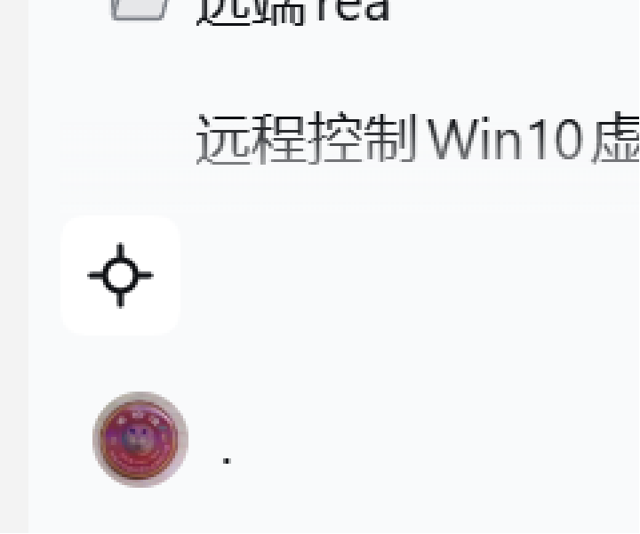
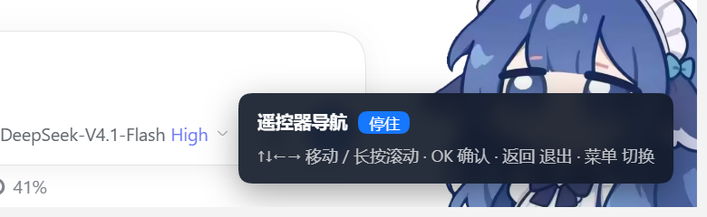

# dsh-plugin-remote-nav

[](LICENSE)


> 当前版本 **1.3.0-beta.4（测试版）**：行为仍可能调整。

给 **DeepSeek Harness（DSH）Web UI** 加「遥控器 / 方向键导航模式」：用遥控器、手柄或纯键盘，
按屏幕**视觉位置**在界面里移动焦点，适合 TV、盒子、客厅电脑等场景。

这是 DSH 的**内置插件**（profile bundle），不依赖油猴脚本或浏览器扩展。


## 功能特性

- `↑↓←→` 按屏幕几何位置移动焦点（与 DOM 顺序无关），`Enter` / OK 激活，返回键退出。
- 阅读长会话时，上下键在正文里连续滚动，**长按自动加速**（1x → 3x）；按到底不会跳到工作区等其他列。
- 被粘性输入框或弹层挡住的内容不会被框选，滚动回来也不会出现“虚空选框”。
- 修改文件卡片、工具详情里的文件路径、Markdown 文件引用默认不算导航目标；
  「加载更早」也不会抢走上键。
- 从会话正文按上键时优先吸附到顶部页签「对话」，不会被「加载更早」或标题栏按钮截走。
- 打开已有会话后 DSH 会自动聚焦输入框；此时第一次按方向键会先退出输入，避免光标“卡住”。
- 返回键分层：先退出输入 → 再关闭菜单 / 弹层 → 最后才退出导航模式。
- 会话输入框整张卡片算**一个**目标，底部 `+ / 完全权限 / 模型 / 麦克风 / 发送` 各自可选。
- 聊天里的「思考 / 运行命令」等记录行不作为候选，方向键直接滚动会话。
- 侧边栏底部有常驻开关按钮；不开启导航时对鼠标、键盘、输入框零影响。
- 引擎零依赖，插件卸载时可完整清理监听器、HUD 与样式。

## 界面预览

| 侧边栏开关 | 导航 HUD |
| --- | --- |
|  |  |

## 安装

### 前置条件

- DSH 桌面端或 DSH Web（0.2.x 系列）。
- Node.js ≥ 22（仅构建与测试需要，插件运行时不依赖 Node 模块）。

### 从 GitHub 安装

仓库在 `package.json` 中声明了 `dsh.bundle`，推送到 GitHub 后可以直接按仓库地址安装：

```bash
dsh plugin add github:scientificmaniac/dsh-plugin-remote-nav
```

> owner/repo 按本仓库的实际地址替换；当前仓库地址尚未最终确定，见 [docs/收录与市场.md](docs/收录与市场.md)。
> 具体安装命令以你使用的 DSH 版本为准。

仓库已提交预构建的 `client.js`，从源码安装**不需要执行构建步骤**。

### 本地目录安装（开发）

把仓库克隆或下载到本地任意目录（路径可包含中文），然后让 Agent 或插件管理安装这个**本地 bundle**：

```js
plugin_manager({ action: 'install_bundle', target: '插件路径' })
```

安装完成后：

1. 插件清单里出现「遥控器导航」一行（标题、描述来自 `locale/`，图标来自 `icon.svg`）；
2. Web UI 侧边栏底部出现 D-pad 开关按钮；
3. 向导出的 profile 包以 `link:` 方式引用本目录，仓库移动位置后需要重新安装。

### 更新已安装的插件

```js
plugin_manager({ action: 'remove_bundle', target: 'dsh-plugin-remote-nav' })
plugin_manager({ action: 'install_bundle', target: '插件路径' })
```

也可以重开 DSH 桌面端。注意：更新 `client.js`（客户端代码）需要界面重新加载后才生效。

## 使用

### 开关导航

| 操作 | 说明 |
| --- | --- |
| 侧边栏底部 D-pad 按钮 | 点击开 / 关导航模式（按钮高亮表示已开启） |
| 遥控器菜单键（`ContextMenu` / keyCode 82） | 开 / 关导航模式 |
| `F9` | 同上（接键盘调试用） |
| URL 带 `?remote=1` | 打开页面即自动开启（TV 快捷方式 / kiosk 用） |
| `dshNav.enable()` / `disable()` / `toggle()` | 控制台编程控制 |

开启后右下角出现常驻 HUD，显示当前模式（停住 / 循环）与键位提示。

### 键位

| 键 | 行为 |
| --- | --- |
| `↑↓←→` | 移动焦点；无焦点时首次按键选中“视觉左上第一个” |
| 会话内 `↑↓` | 没有候选可去时滚动会话正文，按住会持续加速 |
| `Enter` / OK | 激活当前焦点（输入卡片 → 进入输入；其余 → 点击） |
| `Esc` / 返回 | 分层：输入框内 → 退出输入；有菜单 / 弹层 → 关闭它；否则退出导航 |

### 会话阅读与输入框

- 阅读正文时，`↑↓` 优先滚动会话；滚到正文末尾再按向下，才会进入输入框。
- 输入卡片 = 一个大框：选中后按 OK 进入文字输入；底部按钮仍可逐个选中。
- 进入已有会话时输入框会自动聚焦；第一次按方向键会退出输入、把光标放回输入卡片。
  想保留输入框内的原生方向键行为，执行：

  ```js
  dshNav.set('leaveEditingOnArrow', false);
  ```

- 聊天记录里的「思考 / 运行命令」等展开记录行（`[data-disclosure-row]`）不会被框住。

### 配置

```js
dshNav.set('wrap', true);                 // 边界循环（默认 false = 停住 + 回弹）
dshNav.set('entry', 'center');            // 首焦点：top-left | center | dom-first
dshNav.set('scrollFollow', false);        // 关掉滚动跟随
dshNav.set('highlightPadding', 8);        // 高亮留白
dshNav.set('leaveEditingOnArrow', false); // 输入框内保留原生方向键
dshNav.set('scrollStep', 48);             // 会话滚动单步(px)
dshNav.set('scrollAccelerate', true);     // 长按加速开关
dshNav.set('scrollAccelMax', 3);          // 加速上限倍数
dshNav.set('scrollAccelRampMs', 900);     // 加速到上限所需的按住时长
dshNav.set('scrollColumnLock', false);    // 关闭“阅读时上下键锁在本列”
dshNav.set('preferHeaderTabOnUp', false); // 关闭“正文按上键优先吸附到对话页签”
dshNav.set('skipFileLinks', false);       // 让 Markdown 文件引用按钮重新可选中
```

完整参数见 [`src/remote-nav.js`](src/remote-nav.js) 的 `DEFAULTS`。
配置保存在 `localStorage` 的 `dsh:remoteNav:config`，清除即恢复默认。

### 诊断

```js
dshNav.diagnose();  // 打印候选元素统计与前 12 个候选
```

若某些自定义元素选不中：

```js
dshNav.set('extraSelector', '.chat-card,[data-testid="action"]');
```

或在组件上添加 `data-remote-nav` 属性直接入候选。

## 目录结构

```
index.js                  宿主侧 Cordis 入口（占位；能力在客户端）
client.js                 DSH Web UI 客户端插件（构建产物，安装时直接使用）
cordis.patch.yml          Loader 补丁：插入宿主插件行
locale/                   插件清单里的标题 / 描述（中文、英文）
icon.svg                  插件图标（DSH 插件清单）
assets/icon-180.png       插件市场图标（GitHub 托管位图）
screenshots.json          插件市场截图声明（1–8 张）
src/remote-nav.js         核心引擎：寻路 / 边界 / 滚动 / 返回键 / 高亮
src/dsh-autostart.js      页面侧引导：挂载 / HUD / 菜单键 / 诊断 / 可逆 destroy
src/dsh-client.js         客户端插件入口：apply、侧边栏开关按钮、locale
src/remote-nav.css        高亮、HUD、开关按钮样式
scripts/build.mjs         构建：把 src/ 拼成 client.js
tests/                    寻路单测 + 客户端插件测试
demo/                     开发演示与行为自检页（直接加载 src/ 源码）
docs/                     架构说明、验证记录、收录与市场资料、截图
```

## 开发与测试

```bash
npm run build   # 重新生成 client.js（改了 src/ 后必须执行）
npm test        # 寻路单测 + 客户端插件测试
npm run demo    # 本地静态服务器，http://127.0.0.1:8125/demo/standalone.html
```

- `demo/standalone.html`：模拟 DSH 界面，验证导航、HUD、滚动。
- `demo/behavior.html`：行为自检页（候选过滤 / 输入框分组 / 返回键 / 长按加速）。
- `demo/index.html`：核心引擎演示（DOM 乱序、动态新增、滚动、输入保护）。

演示页通过 ESM 直接加载 `src/`，不依赖构建产物，因此需要用 `npm run demo` 起本地 HTTP 服务
（直接双击 `file://` 打开会因模块跨域限制无法加载）。

仓库内的 `client.js` 是构建产物，必须随源码一起提交；安装 DSH 插件时直接使用它。

## 市场与收录

本仓库按 DSH 插件收录规范准备：

- **市场图标**：`assets/icon-180.png`（180×180 方形 PNG，GitHub 托管）；
- **市场截图**：根目录 `screenshots.json` 声明 2 张（导航 HUD、侧边栏开关）；
- **收录条目**：可直接提交到 awesome-dsh-plugin 的条目文件与逐项检查清单见 [docs/收录与市场.md](docs/收录与市场.md)；
- **manifest**：`package.json` 的 `dsh.bundle.patch` 指向 `cordis.patch.yml`，满足 `dsh plugin add` 的安装条件。

> 推送到 GitHub 后还需要：给仓库添加 `dsh-plugin` topic，并等仓库创建满 1 天再提交收录 PR。

## 文档

- [架构说明](docs/架构说明.md)：bundle 结构、客户端生命周期、与 DSH DOM 的协作约定。
- [验证记录](docs/验证记录.md)：自动化测试、浏览器自检、真机验证与限制。
- [更新日志](CHANGELOG.md)
- [贡献指南](CONTRIBUTING.md)

## 已知限制

1. 依赖几何布局：`transform` 缩放 / 旋转的元素、虚拟列表只渲染可见项时，跨屏导航需要额外处理。
2. 不劫持 `Tab`（原生顺序照旧）；输入框内方向键默认先退出输入（`leaveEditingOnArrow: false` 可保留原生光标），回车在输入框内仍照常发送。
3. 客户端插件更新（改 `client.js`）需要界面重新加载后才生效；只改宿主侧配置不需要。
4. DSH 仍是快速迭代中的项目，本插件依赖的 `data-*` DOM 约定记录在[架构说明](docs/架构说明.md)，版本升级后若失效可在 `src/remote-nav.js` 的 `DEFAULTS` 中调整。

## 贡献

欢迎提交 Issue / Pull Request。提交前请阅读[贡献指南](CONTRIBUTING.md)：
所有文档与提交说明使用简体中文，改完 `src/` 后执行 `npm run build && npm test`。

## 许可证

[MIT](LICENSE)
